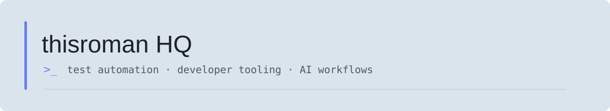
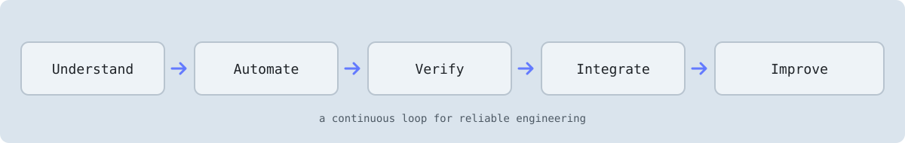

  <picture>
    <source media="(prefers-color-scheme: dark)" srcset="./banner-dark.svg">
    <source media="(prefers-color-scheme: light)" srcset="./banner-light.svg">
    
  </picture>

  
  
  

> Practical tools for reliable software and less repetitive engineering.

## Focus

| Quality engineering | Developer workflows | AI & agents |
| --- | --- | --- |
| Web, API, and end-to-end testing | CI/CD and reusable tooling | Agent skills, MCP, and n8n workflows |

  <picture>
    <source media="(prefers-color-scheme: dark)" srcset="./workflow-dark.svg">
    <source media="(prefers-color-scheme: light)" srcset="./workflow-light.svg">
    
  </picture>

## Featured project

### [Agent Skills](https://github.com/thisromanHQ/agent-skills)

Reusable skills for tool integrations and agent workflows, with an emphasis on safe operations, explicit confirmation, and verifiable results.

## Tools I use

  
  
  
  
  

## About

I’m Roman Pinchuk, a Senior Automation Engineer & SDET focused on scalable test automation, CI/CD improvement, and practical AI-assisted engineering.

[Website](https://thisroman.dev) · [CV](https://cv.thisroman.dev) · [LinkedIn](https://www.linkedin.com/in/roman-pinchuk) · [GitHub](https://github.com/roman-pinchuk)
